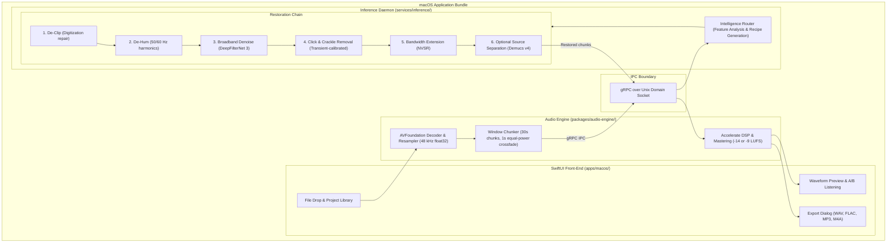

# Sangeet AI

Sangeet AI is a macOS desktop application that restores and remasters vintage Indian music recordings using AI.

It removes historical recording flaws—tape hiss, 78rpm surface noise, mains hum, and digital clipping—without stripping away the soul of the performance. Unlike generic Western-tuned restoration tools that flatten nasal vocal delivery or erase microtonal slides (*meend*, *andolan*), Sangeet AI protects sympathetic string resonances and tabla transients. All processing runs 100% locally on your Mac, so your audio never leaves your machine.

## Prerequisites

- macOS 13.0 (Ventura) or later
- Apple Silicon Mac (M-series recommended for MPS acceleration) or Intel Mac
- Xcode 15.0 or later (Swift 5.10)
- Python 3.11 (strictly pinned for inference daemon stability)
- `protoc` with Swift and Python plugins

## Installation

1. **Clone the repository:**
   ```bash
   git clone https://github.com/rahulchaturvedi/AI_Audio_Restoration.git
   cd AI_Audio_Restoration
   ```

2. **Set up the Python inference environment:**
   ```bash
   cd services/inference
   python3.11 -m venv .venv
   source .venv/bin/activate
   pip install --upgrade pip
   pip install -e ".[dev]"
   cd ../..
   ```

3. **Generate gRPC stubs:**
   ```bash
   make proto
   ```

## Quick Start

1. **Verify your local build:**
   ```bash
   make lint
   make test
   ```

2. **Open the macOS app project:**
   ```bash
   open apps/macos/SangeetAI.xcodeproj
   ```

3. **Build and run in Xcode:**
   - Select the `SangeetAI` scheme and your Mac target.
   - Press **Cmd + R** to run.
   - Drop an audio file (WAV, FLAC, MP3, or M4A) into the window to analyze and restore.

## Architecture

Sangeet AI separates UI and low-latency audio streaming from heavy machine-learning execution. The native Swift layer handles UI and DSP chunking, while a background Python daemon orchestrates deep-learning restoration models over a local Unix domain socket.



### Signal Chain Principles

- **Cultural Preservation:** Restoration stages are tuned to prevent false positives on Indian instrumentation. Click detection preserves sharp tabla attacks, denoisers protect vocal chest resonance and sympathetic tanpura/sitar drones, and bandwidth extension avoids synthetic high-frequency glare.
- **Audio Standards:** Internal audio representation is float32 at 48 kHz across all stages.
- **Chunk Management:** 30-second windows with 1-second overlaps and equal-power cosine crossfades eliminate boundary seams and phase artifacts.
- **Mastering Presets:** Streaming target (-14 LUFS, -1 dBTP) and Remaster target (-9 LUFS, -1 dBTP).

## Repository Layout

```
AI_Audio_Restoration/
├── AGENTS.md                  # Project constitution and multi-agent directives
├── .agents/                   # Coding standards, DSP rules, and workflows
├── apps/
│   └── macos/                 # SwiftUI native macOS application
├── packages/
│   └── audio-engine/          # Swift AVFoundation & Accelerate DSP package
├── services/
│   └── inference/             # Python ML daemon (DeepFilterNet 3, NVSR, Demucs)
├── proto/                     # Protocol Buffer definitions (sangeet/v1)
├── eval/                      # Evaluation harness & audio benchmark corpus
└── scripts/                   # Build, code signing, and notarization scripts
```

## Development Commands

All standard development targets run via the root `Makefile`:

- `make proto` — Regenerates Python and Swift gRPC stubs from `proto/sangeet/v1/`.
- `make lint` — Runs `ruff`, `mypy --strict`, and `swiftlint`.
- `make format` — Automatically formats Python (`black`, `ruff`) and Swift files.
- `make test` — Executes Swift XCTest suites and Python `pytest` suites.
- `make eval` — Runs the objective evaluation harness against test audio segments.
- `make build-daemon` — Packages the Python daemon with PyInstaller for bundle distribution.

## License

This project is proprietary commercial software distributed under the Sangeet AI End User License Agreement (EULA). Third-party open-source components and model weights are used strictly under their respective commercial-permissive licenses (Apache 2.0, MIT, BSD). See `LICENSE` for details.
